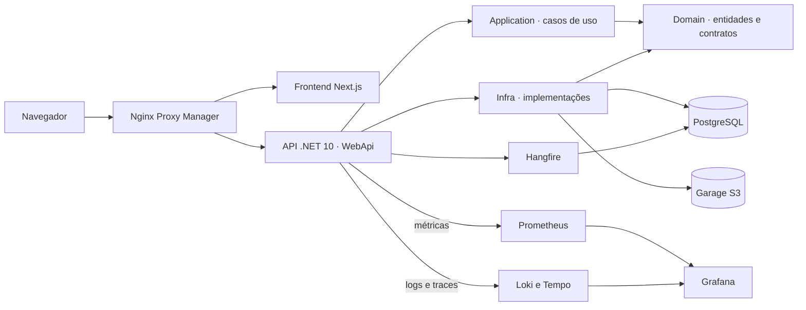

 <!-- COVERAGE_BADGE -->

# Sistema de Gestão de TCCs

Aplicação web para gerenciar Trabalhos de Conclusão de Curso, apoiando os processos de cadastro, orientação, submissão de documentos, defesa e avaliação.

## Tecnologias

| Área | Tecnologias |
| --- | --- |
| Front-end | TypeScript, React, Next.js e Tailwind CSS |
| Componentes de interface | shadcn/ui e Radix UI |
| Formulários e validação | React Hook Form e Zod |
| Back-end | C#, ASP.NET Core e .NET 10 |
| Persistência | PostgreSQL e Entity Framework Core |
| Autenticação | JWT e BCrypt |
| Armazenamento de arquivos | Garage, com API compatível com Amazon S3 |
| Tarefas em segundo plano | Hangfire |
| Documentação da API | Swagger/OpenAPI |
| Testes de back-end | xUnit, NSubstitute e FluentAssertions |
| Contêineres e automação | Docker, Docker Compose e GitHub Actions |
| Observabilidade | OpenTelemetry, Serilog, Grafana, Prometheus, Loki e Tempo |

## Organização do projeto

O sistema é dividido em front-end e API, com o back-end organizado em camadas:

- **frontend:** interface web desenvolvida com Next.js.
- **backend/gestaotcc.WebApi:** endpoints HTTP e configuração da API.
- **backend/gestaotcc.Application:** casos de uso e serviços da aplicação.
- **backend/gestaotcc.Domain:** entidades e contratos do domínio.
- **backend/gestaotcc.Infra:** persistência e integrações com serviços externos.
- **backend/gestaotcc.Test:** testes automatizados do back-end.
- **docs:** documentação técnica, segurança, infraestrutura e releases.

## Arquitetura

## Armazenamento de arquivos

O projeto utiliza o **Garage** para armazenar documentos e outros arquivos da aplicação.

O Garage é um serviço de armazenamento de objetos com API compatível com Amazon S3. A integração do back-end utiliza o **AWS SDK for .NET**, com endpoint, credenciais e bucket definidos na configuração do ambiente.

O Garage é um componente de terceiros, com código-fonte e condições de licenciamento próprios:

- [Site e documentação do Garage](https://garagehq.deuxfleurs.fr/)
- [Repositório do Garage](https://git.deuxfleurs.fr/Deuxfleurs/garage)

## Qualidade e segurança

A esteira de CI/CD reúne testes automatizados, verificação de cobertura e análises de segurança do código, das dependências e da aplicação em execução.

O gate de cobertura exige pelo menos **95% de cobertura global de sequências do back-end**. O badge do README utiliza o percentual aprovado pelo CI da release; sua atualização é proposta por pull request e depende de revisão e integração.

Consulte a documentação técnica:

- [Controles de segurança da aplicação, configuração e limitações](docs/security/tasks-seguranca-2026-11-11.md)
- [Controles de CI/CD, evidências e pendências de infraestrutura](docs/security/ci-cd-auditoria.md)
- [Política de segurança e reporte privado de vulnerabilidades](SECURITY.md)

As evidências de testes e segurança devem ser consultadas na execução correspondente ao commit ou à release analisada.

## Releases e implantação

O fluxo de publicação contempla imagens de front-end e back-end para **linux/amd64** e **linux/arm64**, disponibilizadas no GitHub Container Registry.

- [Releases publicadas](https://github.com/ifpebj-ti/gestao-tccs/releases)
- [Histórico de alterações](CHANGELOG.md)
- [Execuções da esteira de publicação](https://github.com/ifpebj-ti/gestao-tccs/actions/workflows/production.yml)

O ambiente na Oracle Cloud Infrastructure (OCI) já está em uso segundo a equipe. A atualização de uma versão na OCI requer acionamento manual.

## Documentação

A [Wiki do Projeto](https://github.com/ifpebj-ti/gestao-tccs/wiki) reúne informações sobre requisitos, arquitetura e fluxos do sistema.

Para contribuir, consulte o [Guia de Contribuição](CONTRIBUTING.md), que descreve a organização das branches, commits, pull requests, validações e releases.

### Apresentações

- [Sprint Report](https://www.canva.com/design/DAGyh_WU0jU/3eeINFORZW4p_HAiuHqmEg/view?utm_content=DAGyh_WU0jU&utm_campaign=designshare&utm_medium=link2&utm_source=uniquelinks&utlId=hfb7fd3492f)
- [Sprint Report — Melhorias](https://canva.link/o1j60bny3bs02z6)

### Protótipo

Confira o [protótipo interativo no Figma](https://www.figma.com/design/gaL3ToIzCBEcyh09FpyXE1/Gest%C3%A3o-de-TCCs---Gov.BR?node-id=4002-2726&t=aqQQCIGpvvDAxGUC-1).
