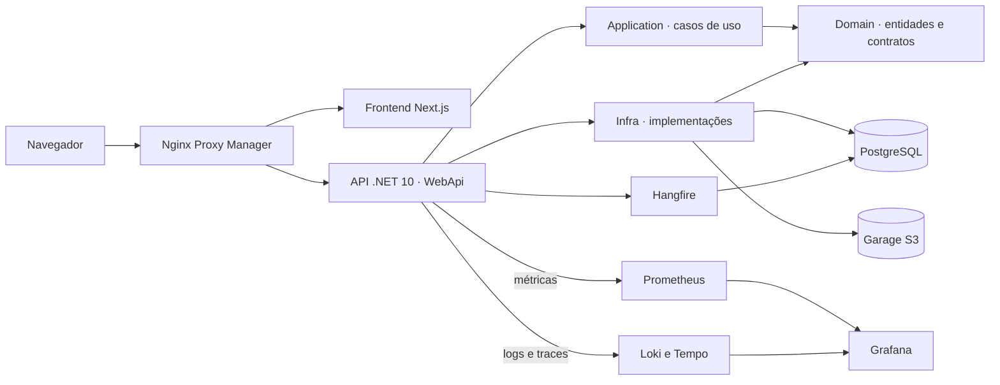

 <!-- COVERAGE_BADGE -->

<!----> <!--Adicionar caso o sistema venha a ter versões separadas por tags-->

# Sistema de Gestão de TCCs

Sistema web para gerenciar Trabalhos de Conclusão de Curso (TCC), automatizando processos como cadastro, orientação, defesa e avaliação.

##  Tecnologias Utilizadas

O ambiente OCI já está em uso segundo a equipe. A promoção de novas versões continua manual. [Controles de CI/CD e evidências de auditoria](docs/security/ci-cd-auditoria.md)

Entrega de segurança da aplicação: [tasks, testes, ativação e pendências para 11/11/2026](docs/security/tasks-seguranca-2026-11-11.md).

- **Front-end:** React, Next.js
- **Back-end:** .Net
- **Banco de Dados:** PostgreSQL

   

## Arquitetura

##  Documentação e Wiki

Acesse a [Wiki do Projeto](https://github.com/ifpebj-ti/gestao-tccs/wiki) para mais detalhes sobre requisitos, arquitetura e fluxo do sistema.

Para contribuir, consulte o [guia de contribuição](CONTRIBUTING.md). Para relatar vulnerabilidades em privado, siga a [política de segurança](SECURITY.md).

**Apresentações do Projeto:**
*  [Sprint Report](https://www.canva.com/design/DAGyh_WU0jU/3eeINFORZW4p_HAiuHqmEg/view?utm_content=DAGyh_WU0jU&utm_campaign=designshare&utm_medium=link2&utm_source=uniquelinks&utlId=hfb7fd3492f)
*  [Sprint Report Melhorias](https://canva.link/o1j60bny3bs02z6)
  
##  Protótipo

Confira o protótipo interativo no [Figma](https://www.figma.com/design/gaL3ToIzCBEcyh09FpyXE1/Gest%C3%A3o-de-TCCs---Gov.BR?node-id=4002-2726&t=aqQQCIGpvvDAxGUC-1).

## Armazenamento de documentos

A API guarda documentos e assinaturas no Garage por meio da interface compatível com S3 e do AWS SDK para .NET. As variáveis `STORAGE_*` do `.env.example` descrevem a conexão.
