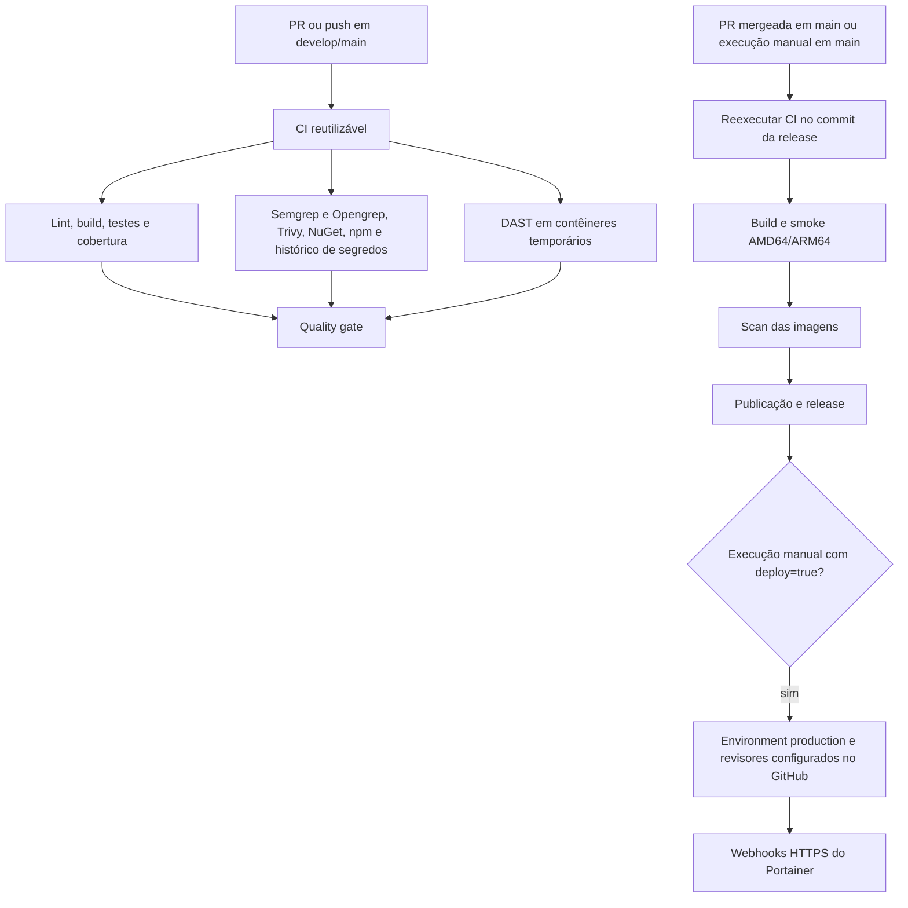

# CI/CD e preparação para a auditoria cruzada

## Escopo e situação real

Esta implementação atende à parte de esteira do Documento de Entregas do Projeto Integrador do 7º Período (seções 10, 14.2, 14.3 e 15) e à atividade de Auditoria de Processo e de Qualidade de Desenvolvimento de Software. Os documentos são referências de critérios; sua presença não comprova conformidade.

**Deploy na OCI pendente:** a conta da integrante responsável ainda aguarda liberação. Não há evidência de implantação, domínio, HTTPS, observabilidade ou rollback na OCI. O CI e o DAST temporário independem dessa conta. Não apresentar esses controles operacionais como concluídos.

A integração preserva os testes da equipe e acrescenta cenários de segurança e integração. A esteira exige **95% de cobertura global de sequências do backend**, sem arredondar resultados para cima e sem excluir componentes para aumentar artificialmente o percentual. Isso não representa cobertura de frontend, 95% de cada módulo ou, isoladamente, qualidade dos testes.

## Fluxo implementado

PRs não recebem segredos de produção. O checkout não persiste credenciais; o token tem leitura por padrão. Escrita de pacotes e releases permanece restrita aos respectivos jobs. A release só começa após o CI do próprio commit passar. O disparo manual fora de `main` não publica nem implanta.

## Política de bloqueio

| Controle | Bloqueio | Evidência |
| --- | --- | --- |
| Validação da esteira | Falha dos testes dos scripts, Actionlint ou ShellCheck | Logs de Pipeline validation |
| Backend | Build/testes falhando; cobertura inferior a 95%; relatório ausente | TRX e OpenCover em backend-evidence |
| Integração PostgreSQL | Falha dos testes com banco descartável | TRX; variável de conexão definida pelo CI |
| Frontend | Lint, testes existentes, build ou TypeScript falhando | Logs do job |
| npm | Vulnerabilidade alta/crítica ou erro de auditoria | frontend-evidence/npm-audit.json |
| NuGet | Vulnerabilidade alta/crítica, inclusive transitiva; erro de relatório | backend-evidence/nuget-audit.json |
| Semgrep e Opengrep | Qualquer finding das regras selecionadas; erro de scanner | sast-evidence/frontend-sast.sarif e backend-sast.sarif |
| Trivy, repositório e imagens | Qualquer vulnerabilidade alta/crítica, inclusive sem correção disponível | JSON de SCA e de imagens |
| Histórico de segredos | Detecção no histórico completo das refs obtidas pelo checkout | sca-secrets-evidence/gitleaks.sarif, com valores redigidos |
| DAST | Alerta alto; falha operacional; relatório ausente | dast-evidence, JSON e HTML por serviço |
| Gate agregado | Qualquer job obrigatório falhando, cancelado ou ignorado | Check Quality gate |

Achados médios/baixos continuam nos relatórios e precisam de triagem e PAC. Não equivalem a riscos aceitos automaticamente. Vulnerabilidades altas/críticas sem correção disponível também bloqueiam: avaliar troca da dependência ou imagem base. A política adota o critério mais estrito da segunda unidade (zero altas/críticas), sem baseline que esconda achados antigos.

Trivy e Gitleaks usam versões explícitas e validação dos checksums publicados na release. Opengrep 1.33.1 usa executável oficial com SHA-256 fixado; as Actions estão fixadas por SHA, com comentários das versões. O ZAP usa versão explícita. As regras remotas e bases de vulnerabilidade podem mudar entre execuções; pinagem das imagens por digest permanece uma melhoria possível.

## DAST e seus limites

`scripts/dast.sh` constrói as imagens do código em análise e cria uma rede e três contêineres exclusivos: PostgreSQL, API e frontend. Não publica portas no host, não recebe dados ou credenciais da OCI e remove os contêineres e volumes ao terminar.

O ZAP Baseline faz crawling e análise passiva das páginas públicas. O API Scan usa o OpenAPI da API em `Development` e executa análise ativa no banco descartável. O gate considera a severidade do JSON; o código de aviso do ZAP não é tratado como falha operacional, mas relatório ausente sempre bloqueia. Logs e relatórios são preservados inclusive quando há falha.

Limitações: não há sessão autenticada por perfil, serviço de armazenamento real ou e-mail funcional nesse ambiente. O scan não comprova segurança dos uploads, fluxos autenticados, IDOR, isolamento de instituições, recuperação de senha ou proteção de documentos. Testar esses controles com contas fictícias por perfil, sem dados reais, faz parte da auditoria complementar. Swagger em Development não representa sua exposição em produção. HTTPS e proxy deverão ser validados depois do provisionamento.

## Configurações que precisam existir no GitHub

Arquivos de workflow não ativam Branch Protection. Antes de classificar a maturidade como nível 4 ou 5, configurar e comprovar:

1. Rulesets em `main` e `develop`: PR obrigatória, pelo menos uma aprovação de outra pessoa, invalidar aprovações após novos commits, resolver conversas, exigir branch atualizada e checks obrigatórios; impedir force push e exclusão. Revisar bypass de administradores e apps.
2. Após a primeira execução, selecionar o check **Quality gate** emitido pelo CI normal como obrigatório. Confirmar seu nome exato na interface. A release reutilizável terá contexto próprio.
3. Environment `production`: permitir somente `main`, exigir revisores, impedir autoaprovação quando disponível e cadastrar os dois `PORTAINER_WEBHOOK_*` como segredos do environment. A disponibilidade dessas opções depende do plano/visibilidade do repositório.
4. Ativar Dependency Graph, alertas Dependabot e, quando disponíveis, secret scanning e push protection. O arquivo dependabot.yml agenda atualizações de npm, NuGet, Actions e Docker; não ativa essas configurações por si só.
5. Conceder leitura do repositório e do Projects aos auditores. Disponibilizar ambiente de teste separado quando houver OCI.

Revisão técnica precisa ter discussão e verificação de critérios de aceite. Aprovação obrigatória não mede a qualidade da revisão. Registrar comentário técnico, resultado dos testes e decisão do revisor.

## Deploy quando a OCI estiver disponível

O merge em `main` pode gerar imagens e release depois dos bloqueios, mas não chama Portainer. O input `deploy` de production.yml é `false` por padrão. Manter assim até terminar provisionamento e validação do ambiente.

Antes de optar por deploy: configurar VM, firewall, domínio, certificado válido e proxy; armazenamento privado; segredos externos ao Git; banco persistente com backup e restauração testada; serviços no Portainer; observabilidade e verificação de saúde. Os dois webhooks devem existir e usar HTTPS válido. Certificado inválido falha: não recolocar `curl -k`.

O opt-in manual atual **cria uma nova release validada e então chama os webhooks**. Não é um mecanismo de promoção independente de uma release antiga. Os dois POSTs não são atômicos: se o segundo falhar, o primeiro pode já ter atualizado. A promoção de `latest` também não constitui transação entre os serviços. Antes do primeiro deploy real, definir promoção por digest/versão, smoke externo e rollback para os digests anteriores; testar em staging. A execução não prova sucesso operacional apenas porque os webhooks responderam.

## Evidências para entregar aos auditores

Para cada evidência registrar commit SHA, URL do workflow/run e artifact, data, ferramenta/versão e conclusão. Os artifacts expiram em 14 dias; exportar para o dossiê de auditoria antes disso, com acesso restrito. Relatórios podem conter caminhos, detalhes de falhas e dados sintéticos; mesmo com segredos redigidos, revisar o conteúdo antes de compartilhá-lo.

| Requisito | Evidência a obter | Situação |
| --- | --- | --- |
| Testes e segurança bloqueiam release | Run positivo e run negativo de demonstração em branch de teste | Configurado; execução no GitHub pendente |
| Cobertura mínima de 95% | OpenCover do commit avaliado | Medir no commit integrado; não presumir percentual |
| PR e revisão obrigatórias | Captura/export do ruleset + PR real revisada | Configuração e comprovação pendentes |
| SAST/SCA/segredos | SARIF/JSON + triagem dos achados | Scanners configurados; resultado real precisa ser avaliado |
| DAST automatizado temporário | Relatórios por serviço e logs de criação/limpeza | Configurado; escopo autenticado pendente |
| Rastreabilidade | Issue → branch → PR → execução → release/demo | Exige uso real pela equipe |
| Publicação multiarch | Run da release + digests e arquitetura de cada imagem | Fluxo existente preservado; nova execução pendente |
| Deploy e HTTPS | URL OCI, certificado, logs, smoke e rollback | Bloqueado pela liberação da conta OCI |
| Qualidade, Wiki e Projects | Painel da ferramenta de qualidade, links e histórico | Fora da validação apenas local; verificar no GitHub |

Não atribuir automaticamente score 5. O documento exige governança efetiva e evidências de funcionamento, além do YAML.

## Plano de ação corretiva inicial

As descobertas desta seção registram a primeira inspeção e o primeiro DAST. O endurecimento posterior da aplicação, com controles implementados, validação e pendências, está nas [tasks de segurança para 11/11/2026](tasks-seguranca-2026-11-11.md). Relatórios antigos não comprovam o resultado do código posterior às correções.

| ID | Descoberta inicial | Ação | Responsável sugerido | Aceite |
| --- | --- | --- | --- | --- |
| CI-01 | npm audit, SCA e DAST permitiam falhas | Gates e relatórios sem neutralizar erro | DevSecOps | Run com achado bloqueia release |
| CI-02 | Produção não dependia do CI de segurança | Reutilizar CI antes da release | DevSecOps | Mesmo SHA em testes e release |
| CI-03 | DAST apontava para domínio público presumido | Ambiente temporário do próprio commit | DevSecOps | Scan sem acesso à produção |
| CI-04 | Webhooks ignoravam certificado TLS | Exigir HTTPS e certificado válido | DevSecOps/Infra | Certificado inválido bloqueia POST |
| GOV-01 | Proteções/revisores não comprovados localmente | Configurar e exportar rulesets | Administrador do repositório | Merge sem aprovação/check rejeitado |
| SEC-01 | Resultado do histórico de segredos desconhecido | Rodar Gitleaks, triar e rotacionar credenciais reais se detectadas | DevSecOps e donos das credenciais | Credenciais expostas revogadas; nova evidência |
| SEC-02 | Backend e imagens usam .NET 8, cujo suporte termina em 10/11/2026 | Planejar migração para LTS suportada, incluindo SDK, runtime, EF, pacotes, imagens e testes | Backend + DevSecOps | Build, testes e scans aprovados na versão suportada |
| SEC-03 | ZAP local detectou ausência de CSP e proteção contra clickjacking no frontend (risco médio) | Definir CSP compatível com Next.js e documentos, aplicar frame-ancestors/X-Frame-Options e revalidar | Frontend + DevSecOps | Testes dos fluxos e novo scan sem esses achados |
| SEC-04 | ZAP local apontou ausência de nosniff/Permissions-Policy e exposição de X-Powered-By no frontend (risco baixo) | Aplicar cabeçalhos e remover identificação desnecessária do servidor | Frontend + DevSecOps | Respostas HTTP e novo scan comprovam correção |
| SEC-05 | ZAP local recebeu HTTP 500 e indicou detalhes de erro em /api/Tcc/code/send e /api/Tcc/code/verify (risco baixo) | Reproduzir com serviços de teste completos; conferir validação, tratamento de exceções e ausência de dados sensíveis | Backend + DevSecOps | Falhas esperadas têm respostas controladas; origem confirmada e novo scan registrado |
| TEST-01 | Manter cobertura após alterações | Preservar testes existentes e ampliar cenários dos fluxos críticos | Equipe | Relatório global real ≥95% |
| OPS-01 | OCI ainda indisponível | Acompanhar liberação e depois provisionar staging | Responsável OCI | Ambiente e checklist operacional validados |

Criar issues reais para os itens e preencher responsáveis, sprint e links. Esta tabela não cria issues nem comprova correções em execução. Não remover histórico nem adicionar suppressions amplas para fazer um scanner passar. Falso positivo precisa de justificativa específica, revisão e prazo.

O encerramento de suporte do .NET 8 em 10/11/2026 consta na [política oficial da Microsoft](https://dotnet.microsoft.com/en-us/platform/support/policy/dotnet-core). A migração do framework da aplicação não foi incluída nesta mudança de esteira e precisa ser coordenada com a frente de testes. Um scan sem CVEs não comprova suporte do runtime.

## Validação local da mudança — 10/11/2026

| Verificação | Resultado observado |
| --- | --- |
| Scripts de publicação e bloqueios de segurança, Node test runner | 39 testes aprovados |
| Scripts Python de cobertura, unittest em Python 3.12 | 6 testes aprovados |
| Actionlint e ShellCheck em contêineres locais | Sem erros na validação dos workflows e scripts modificados |
| Testes existentes do frontend | 107 aprovados; lint sem erros |
| Build Linux do frontend | Build Next.js e verificação TypeScript aprovados |
| Build e testes existentes do backend, .NET 8 em contêiner | Build aprovado; 345 testes aprovados; 11 testes PostgreSQL ignorados nesta execução sem conexão de integração |
| Inicialização do ambiente DAST | API com Swagger e frontend responderam; três contêineres sem portas publicadas no host |
| ZAP Baseline do frontend e API Scan do OpenAPI | Concluídos; sem alertas altos no escopo executado; achados médios/baixos registrados no PAC |
| Falha operacional do DAST | Montagem de relatórios incompatível com Git Bash foi detectada e reprovou a etapa; após ajuste, relatórios gerados e gate executado |
| Limpeza do DAST | Os três contêineres temporários foram removidos ao terminar |

Os relatórios locais estão em `reports/dast/web.html`, `web.json`, `api.html`, `api.json` e nos logs ao lado. Essa pasta está no gitignore: contém saídas de execução, não configurações. Preservar os arquivos necessários antes de limpar o ambiente.

A validação local de DAST utilizou ZAP 2.16.1 e reaproveitou, na etapa de scan após corrigir os caminhos do Windows, as imagens construídas do mesmo código de frontend/backend. O alerta de versão desatualizada foi confirmado: a configuração final foi atualizada para ZAP 2.17.0, cuja execução no GitHub ainda está pendente. A espera do PostgreSQL também foi endurecida para exigir conexão TCP. Não confundir o resultado local com uma execução completa da configuração final no GitHub.

A execução #127 do PR #753 aprovou testes PostgreSQL, cobertura, NuGet/npm, SCA/histórico, DAST e validação da esteira. O SAST apontou zero vulnerabilidades bloqueantes, mas falhou por incompatibilidade do parser com C# 12; a troca do motor e as evidências estão em [triagem do PR](triagem-ci-pr-753.md). O DAST sem sessão autenticada não comprova ausência de falhas nos fluxos protegidos. Nenhuma imagem foi publicada e nenhum deploy OCI foi acionado nessa validação.

## Referências das ferramentas

- [Opengrep e suporte de linguagens](https://github.com/opengrep/opengrep)
- [ZAP Baseline: análise passiva e códigos de saída](https://www.zaproxy.org/docs/docker/baseline-scan/)
- [Gitleaks: varredura do Git e redação dos resultados](https://github.com/gitleaks/gitleaks)
- [Trivy: relatórios e formatos](https://trivy.dev/docs/dev/guide/configuration/reporting/)
